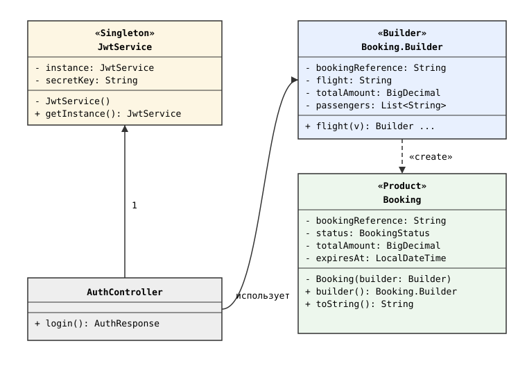
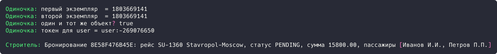

## Цель работы

Реализовать решение задачи из предметной области с использованием порождающих паттернов «Строитель» и «Одиночка». Предметная область: приложение бронирования авиабилетов aviacassa (Java, Spring Boot).

## Краткие теоретические сведения

**Одиночка (Singleton)** гарантирует, что у класса есть только один экземпляр, и дает глобальную точку доступа к нему. Конструктор делается закрытым, а получение объекта возможно только через статический метод, который при первом вызове создает экземпляр и сохраняет его в статическом поле.

**Строитель (Builder)** собирает сложный объект пошагово: отдельный класс-строитель задает поля цепочкой методов, а завершающий метод build() проверяет обязательные поля и создает итоговый объект.

## Ход работы

### Анализ кода приложения

Паттерн «Одиночка» применяется на уровне контейнера Spring: класс JwtService помечен аннотацией `@Service`, поэтому контейнер создает его единственный экземпляр и внедряет один и тот же объект во все места использования.

```java
@Service
public class JwtService {

    @Value("${jwt.secret:aviacassa-secret-key-2026-very-long-for-hs256-safety}")
    private String secretKey;
}
```

Паттерн «Строитель» применяется в сущности Booking (аннотация Lombok `@Builder`) и в сервисе создания бронирований: объект собирается цепочкой вызовов, значения по умолчанию задаются аннотацией `@Builder.Default`. Тем же паттерном пользуется библиотека JWT (Jwts.builder()).

```java
@Entity
@Table(name = "bookings")
@Getter @Setter
@NoArgsConstructor @AllArgsConstructor
@Builder
public class Booking {

    @Id
    @GeneratedValue(strategy = GenerationType.IDENTITY)
    private Long id;

    @Column(name = "booking_reference", nullable = false, unique = true)
    private String bookingReference;

    @Enumerated(EnumType.STRING)
    @Column(nullable = false, length = 20)
    @Builder.Default
    private BookingStatus status = BookingStatus.PENDING;

    @Column(name = "total_amount", nullable = false, precision = 10, scale = 2)
    private BigDecimal totalAmount;

    @Builder.Default
    private List<Passenger> passengers = new ArrayList<>();
}
```

Использование строителя в сервисе бронирований:

```java
@Override
@Transactional
public Booking createBooking(Long flightId, List<PassengerDto> passengers) {
    Flight flight = flightRepository.findById(flightId)
            .orElseThrow(() -> new ValidationException("Рейс не найден"));

    Booking booking = Booking.builder()
            .bookingReference(UUID.randomUUID().toString()
                    .replace("-", "").substring(0, 12).toUpperCase())
            .flight(flight)
            .status(BookingStatus.PENDING)
            .totalAmount(flight.getBasePrice()
                    .multiply(BigDecimal.valueOf(passengers.size())))
            .expiresAt(LocalDateTime.now().plusMinutes(15))
            .build();
    ...
}
```

### Демонстрационная программа

Для демонстрации написана программа на Java. Одиночка реализован классически (закрытый конструктор, двойная проверка блокировки), строитель собран вручную: класс Builder задает поля цепочкой методов, build() проверяет обязательные поля.

```java
class JwtService {
    private static volatile JwtService instance;
    private final String secretKey;

    private JwtService() {
        this.secretKey = "aviacassa-secret-key-2026";
    }

    public static JwtService getInstance() {
        JwtService result = instance;
        if (result == null) {
            synchronized (JwtService.class) {
                result = instance;
                if (result == null) {
                    instance = result = new JwtService();
                }
            }
        }
        return result;
    }

    public String generateToken(String username) {
        return username + ":" + secretKey.hashCode();
    }
}
```

```java
public static class Builder {
    private String bookingReference;
    private String flight;
    private String status = "PENDING";
    private BigDecimal totalAmount;
    private LocalDateTime expiresAt;
    private final List<String> passengers = new ArrayList<>();

    public Builder flight(String value) {
        this.flight = value;
        return this;
    }

    public Builder totalAmount(BigDecimal value) {
        this.totalAmount = value;
        return this;
    }

    public Builder addPassenger(String name) {
        this.passengers.add(name);
        return this;
    }

    public Booking build() {
        if (bookingReference == null) {
            bookingReference = UUID.randomUUID().toString()
                    .replace("-", "").substring(0, 12).toUpperCase();
        }
        if (flight == null) {
            throw new IllegalStateException("Рейс обязателен для бронирования");
        }
        if (totalAmount == null) {
            throw new IllegalStateException("Сумма обязательна для бронирования");
        }
        return new Booking(this);
    }
}
```

Диаграмма классов демонстрационной программы приведена на рисунке 1.



*Рисунок 1 - Диаграмма классов паттернов «Одиночка» и «Строитель»*

В точке входа программы получаются два экземпляра одиночки и сравниваются по ссылке, затем строителем собирается бронирование с двумя пассажирами:

```java
public static void main(String[] args) {
    JwtService first = JwtService.getInstance();
    JwtService second = JwtService.getInstance();
    System.out.println("Одиночка: первый экземпляр  = " + first.hashCode());
    System.out.println("Одиночка: второй экземпляр  = " + second.hashCode());
    System.out.println("Одиночка: один и тот же объект? " + (first == second));
    System.out.println("Одиночка: токен для user = " + first.generateToken("user"));

    Booking booking = new Booking.Builder()
            .flight("SU-1360 Stavropol-Moscow")
            .totalAmount(new BigDecimal("15800.00"))
            .addPassenger("Иванов И.И.")
            .addPassenger("Петров П.П.")
            .expiresAt(LocalDateTime.now().plusMinutes(15))
            .build();
    System.out.println();
    System.out.println("Строитель: " + booking);
}
```

Результат запуска программы показан на рисунке 2.



*Рисунок 2 - Результат выполнения программы*

Результат: оба вызова getInstance() вернули объект с хеш-кодом 1803669141 (сравнение true). Строитель собрал бронирование 8E58F476B45E: статус PENDING, сумма 15800.00, два пассажира.

## Вывод

Изучены порождающие паттерны «Одиночка» и «Строитель». В aviacassa одиночка реализуется контейнером Spring (JwtService), строитель собирает сущность Booking и JWT-токены. Работа паттернов подтверждена демонстрационной программой.
