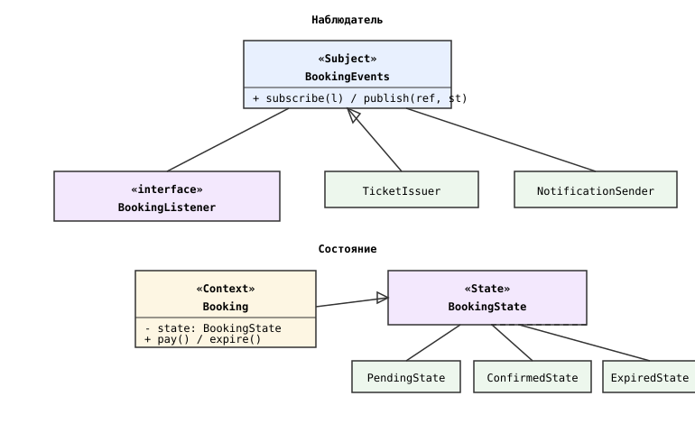
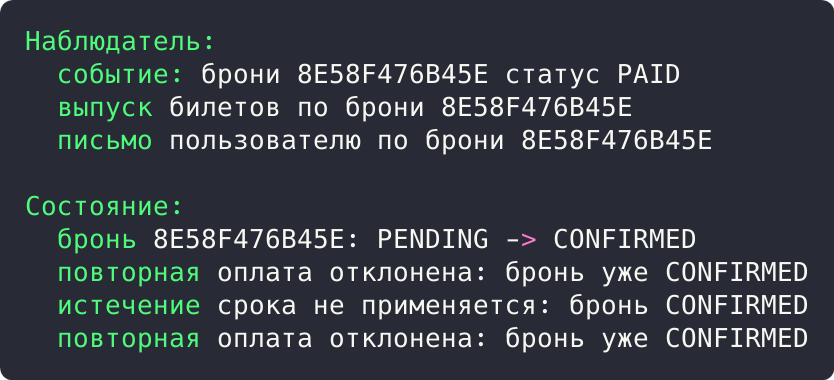

## Цель работы

Реализовать решение задачи из предметной области с использованием поведенческих паттернов «Наблюдатель» и «Состояние». Предметная область: приложение бронирования авиабилетов aviacassa (Java, Spring Boot).

## Краткие теоретические сведения

**Наблюдатель (Observer)** оповещает подписчиков об изменениях состояния объекта: издатель хранит список подписчиков и рассылает им события, не зная их конкретных типов.

**Состояние (State)** позволяет объекту менять поведение при изменении внутреннего состояния: поведение каждого статуса выносится в отдельный класс, а объект делегирует вызовы текущему состоянию.

## Ход работы

### Анализ кода приложения

Паттерн «Наблюдатель» применяется при обработке платежного вебхука: получение статуса PAID от внешней системы является событием, на которое реагируют сразу несколько частей подсистемы (бронирование переводится в CONFIRMED, выпускаются билеты, отправляется уведомление). Spring-инфраструктура (события приложения, транзакционные колбэки JPA) обеспечивает такую рассылку без прямых вызовов между сервисами.

Паттерн «Состояние» применяется в жизненном цикле бронирования: поведение брони определяется перечислением BookingStatus (PENDING, CONFIRMED, CANCELLED, EXPIRED). Для каждого статуса допустимы разные переходы: оплачена может быть только бронь в статусе PENDING, вебхук для уже подтвержденной брони игнорируется, истекший срок действует только для PENDING.

```java
if (booking.getStatus() != BookingStatus.PENDING) {
    throw new ValidationException("Оплата доступна только для бронирований в статусе PENDING");
}
...
if (booking.getStatus() != BookingStatus.PENDING) {
    throw new ValidationException("Бронирование не может быть подтверждено: неверный статус");
}
```

### Демонстрационная программа

Для демонстрации написана программа на Java. Издатель BookingEvents хранит подписчиков BookingListener и рассылает событие об оплате; подписчики TicketIssuer и NotificationSender реагируют независимо. Бронирование делегирует вызовы pay() и expire() текущему объекту-состоянию (PendingState, ConfirmedState, ExpiredState).

```java
class Booking {
    private BookingState state = new PendingState();
    private final String reference;

    public void pay() {
        state.pay(this);
    }

    public void expire() {
        state.expire(this);
    }

    void setState(BookingState state) {
        this.state = state;
    }
}

class ConfirmedState implements BookingState {
    @Override
    public void pay(Booking booking) {
        System.out.println("  повторная оплата отклонена: бронь уже CONFIRMED");
    }

    @Override
    public void expire(Booking booking) {
        System.out.println("  истечение срока не применяется: бронь CONFIRMED");
    }
}
```

Диаграмма классов приведена на рисунке 1.



*Рисунок 1 - Диаграмма классов паттернов «Наблюдатель» и «Состояние»*

В точке входа публикуется событие об оплате брони, затем проверяются переходы статусов: оплата, повторная оплата, попытка истечения и оплата после нее:

```java
public static void main(String[] args) {
    BookingEvents events = new BookingEvents();
    events.subscribe(new TicketIssuer());
    events.subscribe(new NotificationSender());
    events.publish("8E58F476B45E", "PAID");

    Booking booking = new Booking("8E58F476B45E");
    booking.pay();
    booking.pay();
    booking.expire();
    booking.pay();
}
```

Результат запуска программы показан на рисунке 2.



*Рисунок 2 - Результат выполнения программы*

Результат: событие PAID получили оба подписчика (выпуск билетов и письмо). Бронь перешла PENDING в CONFIRMED, повторная оплата и истечение срока отклонены состоянием CONFIRMED, что подтверждает смену поведения при смене статуса.

## Вывод

Изучены поведенческие паттерны «Наблюдатель» и «Состояние». В aviacassa наблюдатель реализован в реакции подсистем на оплату, состояние: в жизненном цикле статусов бронирования. Работа паттернов подтверждена демонстрационной программой.
