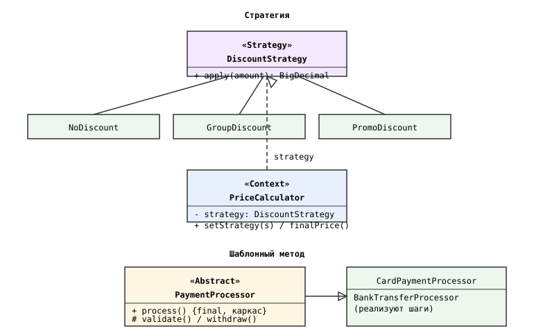
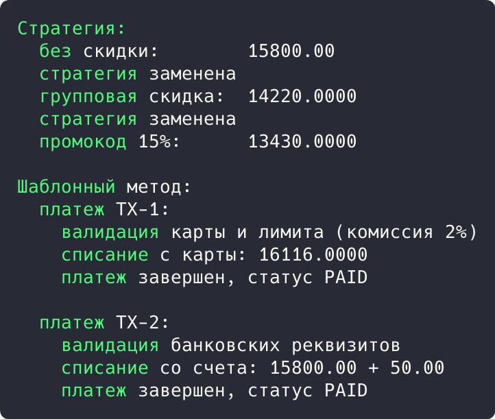

## Цель работы

Реализовать решение задачи из предметной области с использованием поведенческих паттернов «Стратегия» и «Шаблонный метод». Предметная область: приложение бронирования авиабилетов aviacassa (Java, Spring Boot).

## Краткие теоретические сведения

**Стратегия (Strategy)** подменяет алгоритм на лету: семейство алгоритмов выносится в отдельные классы с общим интерфейсом, объект-контекст хранит ссылку на текущую стратегию.

**Шаблонный метод (Template Method)** задает скелет алгоритма в базовом классе, перекладывая реализацию отдельных шагов на подклассы; каркас остается неизменным.

## Ход работы

### Анализ кода приложения

Паттерн «Стратегия» применяется в подсистеме платежей: способ оплаты задается перечислением PaymentMethod (CREDIT_CARD, DEBIT_CARD, BANK_TRANSFER), а каждый способ подразумевает свой алгоритм проверки реквизитов и расчета комиссии. Интерфейсные зависимости Spring (PasswordEncoder с реализацией BCryptPasswordEncoder) также являются стратегиями: алгоритм подменяется конфигурацией.

```java
public enum PaymentMethod {
    CREDIT_CARD,
    DEBIT_CARD,
    BANK_TRANSFER
}
```

Паттерн «Шаблонный метод» применяется в жизненном цикле платежа: последовательность шагов одинакова для всех способов оплаты (валидация, списание, установка статуса PAID), а отличаются только шаги. Общий каркас задан методом processWebhook() сервиса платежей и базовой инфраструктурой Spring (транзакционный шаблон @Transactional).

```java
@Override
@Transactional
public void processWebhook(String transactionId, PaymentStatus status) {
    Payment payment = paymentRepository
            .findByTransactionId(transactionId)
            .orElseThrow(...);
    if (status == PaymentStatus.FAILED) { ... }
    payment.setStatus(status);
    if (status == PaymentStatus.PAID) { ... }
}
```

### Демонстрационная программа

Для демонстрации написана программа на Java. Стратегии скидок (NoDiscount, GroupDiscount, PromoDiscount) подменяются в PriceCalculator методом setStrategy(). Шаблонный метод process() класса PaymentProcessor фиксирует каркас (валидация, списание, статус), подклассы реализуют только шаги.

```java
class PriceCalculator {
    private DiscountStrategy strategy;

    public void setStrategy(DiscountStrategy strategy) {
        this.strategy = strategy;
    }

    public BigDecimal finalPrice(BigDecimal amount) {
        return strategy.apply(amount);
    }
}

abstract class PaymentProcessor {

    public final void process(String transactionId, BigDecimal amount) {
        System.out.println("  платеж " + transactionId + ":");
        if (!validate(amount)) {
            System.out.println("    валидация не пройдена, платеж отклонен");
            return;
        }
        withdraw(amount);
        System.out.println("    платеж завершен, статус PAID");
    }

    protected abstract boolean validate(BigDecimal amount);

    protected abstract void withdraw(BigDecimal amount);
}
```

Диаграмма классов приведена на рисунке 1.



*Рисунок 1 - Диаграмма классов паттернов «Стратегия» и «Шаблонный метод»*

В точке входа сумма последовательно считается с тремя стратегиями скидок, затем обрабатываются платежи картой и банковским переводом:

```java
public static void main(String[] args) {
    BigDecimal amount = new BigDecimal("15800.00");
    PriceCalculator calculator = new PriceCalculator(new NoDiscount());
    System.out.println("  без скидки:        " + calculator.finalPrice(amount));
    calculator.setStrategy(new GroupDiscount());
    System.out.println("  групповая скидка:  " + calculator.finalPrice(amount));
    calculator.setStrategy(new PromoDiscount());
    System.out.println("  промокод 15%:      " + calculator.finalPrice(amount));

    PaymentProcessor card = new CardPaymentProcessor();
    card.process("TX-1", amount);
    PaymentProcessor bank = new BankTransferProcessor();
    bank.process("TX-2", amount);
}
```

Результат запуска программы показан на рисунке 2.



*Рисунок 2 - Результат выполнения программы*

Результат: стратегия дала цены 15800.00, 14220.00 (групповая скидка 10%) и 13430.00 (промокод 15%) без изменения кода калькулятора. Шаблонный метод провел оба платежа по одному каркасу, различаясь шагами валидации и списания (16116.00 с комиссией и 15800.00 плюс фиксированные 50.00).

## Вывод

Изучены поведенческие паттерны «Стратегия» и «Шаблонный метод». В aviacassa стратегией задается способ оплаты и хеширования пароля, шаблонный метод структурирует жизненный цикл платежа. Работа паттернов подтверждена демонстрационной программой.
