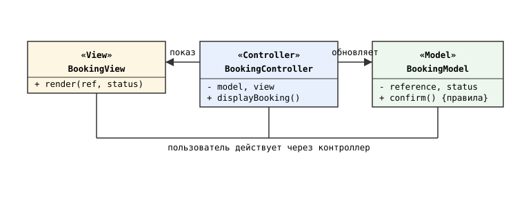
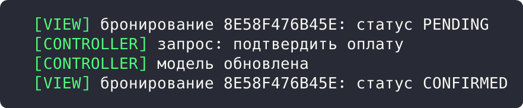

## Цель работы

Реализовать решение задачи из предметной области с использованием архитектурного паттерна MVC (Model-View-Controller). Предметная область: приложение бронирования авиабилетов aviacassa (Java, Spring Boot).

## Краткие теоретические сведения

MVC разделяет приложение на три части: **Model** хранит состояние и бизнес-правила, **View** отображает данные модели, **Controller** принимает действия пользователя, обновляет модель и организует обновление представления.

## Ход работы

### Анализ кода приложения

Приложение aviacassa построено по MVC на стеке Spring: роль Controller выполняют классы BookingController, FlightController, PaymentController (аннотации @RestController, @RequestMapping), роль Model: сервисы и JPA-сущности с бизнес-правилами (Booking, BookingServiceImpl), роль View: JSON-ответы DTO и клиентское React-приложение frontend, которое рендерит данные модели.

```java
@RestController
@RequestMapping("/bookings")
@RequiredArgsConstructor
public class BookingController {

    private final IBookingService bookingService;

    @PostMapping
    public ResponseEntity<BookingDTO> create(
            @RequestBody BookingRequest request) {
        return ResponseEntity.status(HttpStatus.CREATED)
                .body(bookingService.createBooking(request));
    }
}
```

### Демонстрационная программа

Для демонстрации написана консольная программа на Java. BookingModel хранит бронирование и правило перехода статуса, BookingView выводит состояние, BookingController принимает действия и связывает модель с представлением.

```java
class BookingController {
    private final BookingModel model;
    private final BookingView view;

    public void displayBooking() {
        view.render(model.getReference(), model.getStatus());
    }

    public void confirmPayment() {
        System.out.println("  [CONTROLLER] запрос: подтвердить оплату");
        model.confirm();
        System.out.println("  [CONTROLLER] модель обновлена");
    }
}
```

Схема разделения ответственности приведена на рисунке 1.



*Рисунок 1 - Схема паттерна MVC*

В точке входа контроллер дважды отображает бронирование, между которыми подтверждает оплату:

```java
public static void main(String[] args) {
    BookingModel model = new BookingModel("8E58F476B45E", "PENDING");
    BookingView view = new BookingView();
    BookingController controller = new BookingController(model, view);
    controller.displayBooking();
    controller.confirmPayment();
    controller.displayBooking();
}
```

Результат запуска программы показан на рисунке 2.



*Рисунок 2 - Результат выполнения программы*

Результат: представление показало бронь в статусе PENDING, контроллер обработал действие подтверждения оплаты, модель применила бизнес-правило и перешла в CONFIRMED, повторный вывод представления отразил новое состояние.

## Вывод

Изучен архитектурный паттерн MVC. Приложение aviacassa разделено на контроллеры, модель (сервисы и JPA-сущности) и представление (JSON DTO и React-клиент); консольная демонстрация подтвердила разделение ответственности слоев.
