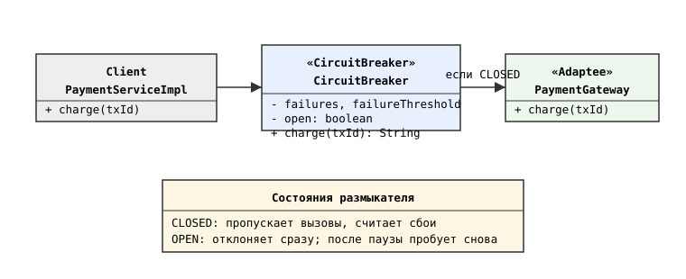
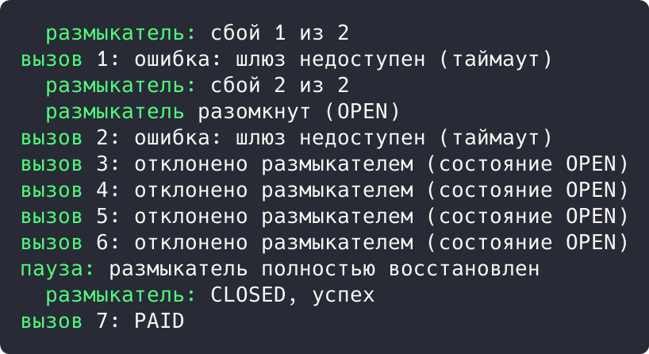

## Цель работы

Реализовать решение задачи из предметной области с использованием паттерна распределенных систем Circuit Breaker. Предметная область: интеграция приложения бронирования авиабилетов aviacassa с внешним платежным шлюзом.

## Краткие теоретические сведения

**Circuit Breaker (размыкатель)** защищает сервис от каскадных сбоев при недоступности внешней зависимости: после серии подряд идущих ошибок вызовы временно отклоняются сразу (OPEN), не тратя время на таймауты; после паузы размыкатель пробует пропустить вызовы снова.

## Ход работы

### Анализ кода приложения

Место применения: PaymentServiceImpl обращается к внешней платежной системе через вебхуки и ожидает статусы PAID или FAILED. При недоступности шлюза платеж зависает в PENDING, а потоки томкат-пула занимаются ожиданием таймаутов. Размыкатель между сервисом и шлюзом отклоняет вызовы на время сбоя и возвращает понятную ошибку клиенту.

```java
@Override
@Transactional
public void processWebhook(String transactionId, PaymentStatus status) {
    Payment payment = paymentRepository
            .findByTransactionId(transactionId)
            .orElseThrow(...);
    if (status == PaymentStatus.FAILED) {
        payment.setStatus(PaymentStatus.FAILED);
        throw new PaymentFailedException("Платеж не прошёл");
    }
    ...
}
```

### Демонстрационная программа

Для демонстрации написана программа на Java. Размыкатель CircuitBreaker оборачивает шлюз: в состоянии CLOSED вызовы пропускаются и считаются сбои; после двух подряд сбоев размыкатель размыкается (OPEN) и отклоняет вызовы без обращения к шлюзу; после паузы сбрасывается в CLOSED.

```java
public String charge(String transactionId) {
    if (open) {
        return "отклонено размыкателем (состояние OPEN)";
    }
    try {
        String result = inner.charge(transactionId);
        failures = 0;
        return result;
    } catch (IllegalStateException e) {
        failures++;
        if (failures >= failureThreshold) {
            open = true;
            System.out.println("  размыкатель разомкнут (OPEN)");
        }
        return "ошибка: " + e.getMessage();
    }
}
```

Схема работы размыкателя приведена на рисунке 1.



В точке входа выполняется серия из семи вызовов шлюза: два падают, размыкатель размыкается, вызовы 3-6 отклоняются мгновенно, после восстановления вызов 7 проходит:

```java
public static void main(String[] args) {
    PaymentGateway gateway = new UnreliablePaymentGateway();
    CircuitBreaker breaker = new CircuitBreaker(gateway, 2);
    for (int i = 1; i <= 6; i++) {
        System.out.println("вызов " + i + ": " + breaker.charge("TX-" + i));
    }
    breaker.reset();
    System.out.println("вызов 7: " + breaker.charge("TX-7"));
}
```

Результат запуска программы показан на рисунке 2.



Результат: после двух сбоев размыкатель перешел в OPEN, вызовы 3-6 отклонены мгновенно без обращения к шлюзу; после сброса вызов 7 успешно прошел (PAID).

## Вывод

Изучен паттерн распределенных систем Circuit Breaker. Он применяется на границе aviacassa с внешним платежным шлюзом: защищает сервис от ожидания таймаутов и каскадных сбоев. Работа паттерна подтверждена демонстрационной программой.
