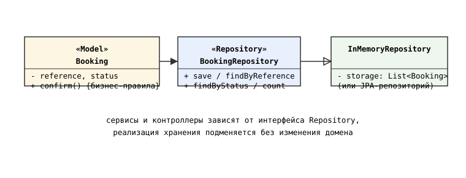
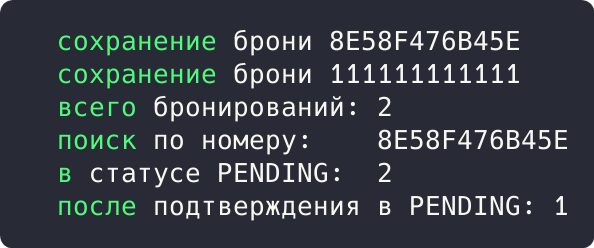

## Цель работы

Реализовать решение задачи из предметной области с использованием паттерна работы с данными Repository. Предметная область: приложение бронирования авиабилетов aviacassa (Java, Spring Boot).

## Краткие теоретические сведения

**Repository** предоставляет коллекцию объектов домена с интерфейсом доступа к данным: сервисы работают с методами save(), findByReference(), не зная, где хранятся данные: в базе, памяти или удаленном сервисе.

## Ход работы

### Анализ кода приложения

Паттерн Repository применяется в проекте в форме Spring Data JPA: интерфейсы BookingRepository, FlightRepository, PaymentRepository объявляют методы поиска, а реализация (SimpleJpaRepository) генерируется автоматически. Сервисы зависят только от интерфейса, что позволяет подменять хранилище и легко тестировать сервисы на моках.

```java
public interface BookingRepository
        extends JpaRepository<Booking, Long> {

    Optional<Booking> findByBookingReference(
            String bookingReference);

    List<Booking> findByStatus(BookingStatus status);
}
```

Сервис использует репозиторий, не зная о деталях хранения:

```java
Booking booking = bookingRepository
        .findByBookingReference(reference)
        .orElseThrow(() -> new ValidationException("Бронирование не найдено"));
```

### Демонстрационная программа

Для демонстрации написана программа на Java. Интерфейс BookingRepository объявляет операции над коллекцией бронирований; реализация InMemoryBookingRepository хранит объекты в списке. Домен (Booking) не зависит от способа хранения.

```java
interface BookingRepository {
    void save(Booking booking);
    Optional<Booking> findByReference(String reference);
    List<Booking> findByStatus(String status);
    long count();
}

class InMemoryBookingRepository implements BookingRepository {
    private final List<Booking> storage = new ArrayList<>();

    @Override
    public Optional<Booking> findByReference(String reference) {
        return storage.stream()
                .filter(b -> b.reference().equals(reference))
                .findFirst();
    }
    ...
}
```

Схема паттерна приведена на рисунке 1.



*Рисунок 1 - Схема паттерна Repository*

В точке входа сохраняются два бронирования, выполняется поиск по номеру и выборка по статусу, затем одна бронь подтверждается:

```java
public static void main(String[] args) {
    BookingRepository repo = new InMemoryBookingRepository();
    repo.save(new Booking("8E58F476B45E", "PENDING"));
    repo.save(new Booking("111111111111", "PENDING"));
    System.out.println("  всего бронирований: " + repo.count());
    System.out.println("  поиск по номеру:    "
            + repo.findByReference("8E58F476B45E")
                  .map(Booking::reference).orElse("не найден"));
    System.out.println("  в статусе PENDING:  "
            + repo.findByStatus("PENDING").size());
}
```

Результат запуска программы показан на рисунке 2.



*Рисунок 2 - Результат выполнения программы*

Результат: два бронирования сохранены в хранилище, поиск по номеру вернул 8E58F476B45E, в статусе PENDING находились обе брони; после подтверждения одной из них выборка по PENDING уменьшилась до одной.

## Вывод

Изучен паттерн Repository. В aviacassa он реализован Spring Data JPA-интерфейсами, отделяющими домен от деталей хранения; консольная демонстрация показала подмену реализации хранилища без изменения доменной модели.
