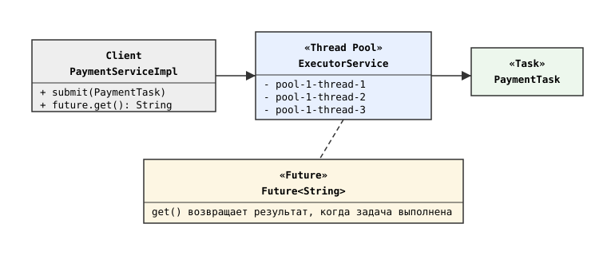
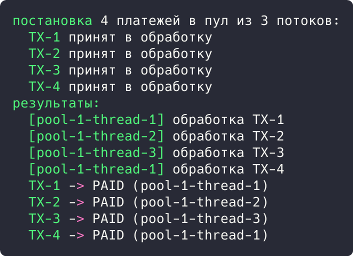

## Цель работы

Реализовать решение задачи из предметной области с использованием идиоматических паттернов «Пул потоков» и «Future». Предметная область: обработка платежей приложения бронирования авиабилетов aviacassa (Java, Spring Boot).

## Краткие теоретические сведения

**Пул потоков (Thread Pool)** содержит фиксированное множество рабочих потоков, которые забирают задачи из очереди: создание потоков выполняется один раз, а перегрузка контролируется размером пула. **Future** представляет результат асинхронной задачи: метод get() блокирует вызывающий поток до готовности результата.

## Ход работы

### Анализ кода приложения

Место применения: пул потоков встроен в саму платформу. Tomcat обрабатывает HTTP-запросы приложения рабочими потоками из пула, а аннотация @Transactional обеспечивает атомарность каждой задачи. Обработка вебхуков платежной системы (processWebhook) выполняется в таком потоке; при всплеске платежей задачи выстраиваются в очередь пула, что защищает приложение от перегрузки.

```java
@Override
@Transactional
public void processWebhook(String transactionId, PaymentStatus status) {
    Payment payment = paymentRepository
            .findByTransactionId(transactionId)
            .orElseThrow(...);
    payment.setStatus(status);
    ...
}
```

### Демонстрационная программа

Для демонстрации написана программа на Java. Пул из трех потоков создается через Executors.newFixedThreadPool(3); задачи PaymentTask (Callable) ставятся методом submit(), который возвращает Future. Метод get() дожидается результата каждой задачи.

```java
ExecutorService pool = Executors.newFixedThreadPool(3);
List<Future<String>> results = new ArrayList<>();
for (int i = 1; i <= 4; i++) {
    String txId = "TX-" + i;
    results.add(pool.submit(new PaymentTask(txId)));
}
for (Future<String> future : results) {
    System.out.println("  " + future.get());
}
pool.shutdown();
```

Схема взаимодействия приведена на рисунке 1.



*Рисунок 1 - Схема паттернов «Пул потоков» и «Future»*

В точке входа четыре платежа ставятся в пул из трех потоков, затем собираются результаты:

```java
public static void main(String[] args) throws Exception {
    ExecutorService pool = Executors.newFixedThreadPool(3);
    List<Future<String>> results = new ArrayList<>();
    for (int i = 1; i <= 4; i++) {
        String txId = "TX-" + i;
        results.add(pool.submit(new PaymentTask(txId)));
        System.out.println("  " + txId + " принят в обработку");
    }
    for (Future<String> future : results) {
        System.out.println("  " + future.get());
    }
    pool.shutdown();
}
```

Результат запуска программы показан на рисунке 2.



*Рисунок 2 - Результат выполнения программы*

Результат: четыре платежа приняты мгновенно; первые три обрабатывались параллельно в потоках 1-3, четвертый дождался освобождения потока 1. Все Future вернули результат PAID, что подтверждает работу пула и сбор результатов.

## Вывод

Изучены идиоматические паттерны «Пул потоков» и «Future». В aviacassa пул потоков встроен в Tomcat и обслуживает HTTP-запросы и вебхуки; демонстрация показала ограничение параллелизма размером пула и сбор результатов через Future.
