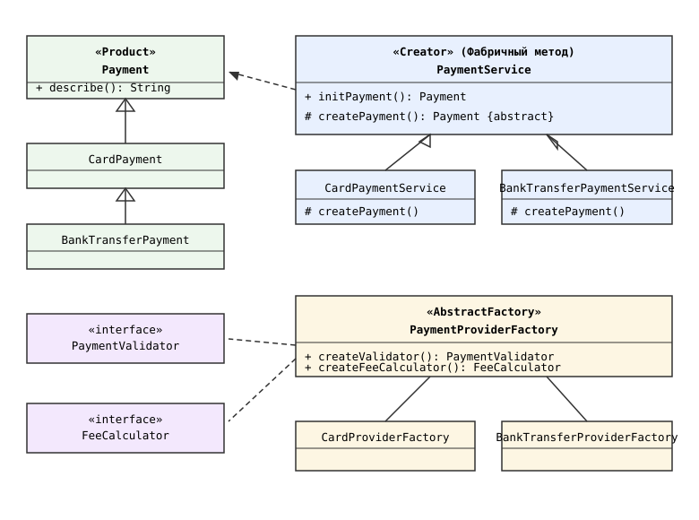
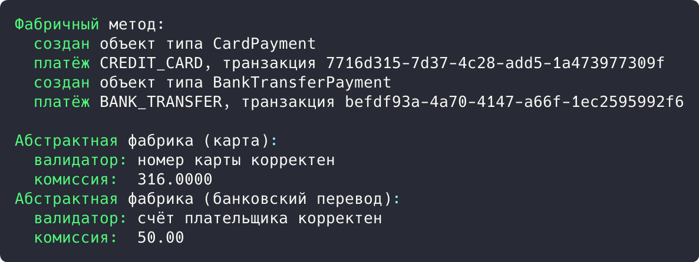

## Цель работы

Реализовать решение задачи из предметной области с использованием двух паттернов из списка: «Абстрактная фабрика», «Фабричный метод», «Прототип». Предметная область: приложение бронирования авиабилетов aviacassa (Java, Spring Boot).

## Краткие теоретические сведения

**Фабричный метод (Factory Method)** определяет интерфейс создания объекта, но позволяет подклассам выбрать класс создаваемого экземпляра. Класс-создатель не привязан к конкретному классу продукта: решение о том, что создавать, принимается в переопределяемом методе подкласса.

**Абстрактная фабрика (Abstract Factory)** создает семейства связанных объектов без привязки к конкретным классам. Фабрика объявляет методы создания каждого продукта семейства, а каждая конкретная фабрика порождает объекты одного варианта (например, одного способа оплаты).

**Прототип (Prototype)** копирует существующие объекты вместо создания с нуля: новые объекты получаются клонированием эталонного экземпляра с изменением части полей. В данной работе из списка выбраны «Фабричный метод» и «Абстрактная фабрика».

## Ход работы

### Анализ кода приложения

Паттерн «Фабричный метод» применяется в проекте aviacassa в конфигурации безопасности. Метод passwordEncoder() возвращает интерфейсный тип PasswordEncoder, а конкретный класс (BCryptPasswordEncoder) известен только внутри метода: вызывающий код получает продукт через общий интерфейс и не зависит от конкретного алгоритма хеширования.

```java
@Bean
public PasswordEncoder passwordEncoder() {
    return new BCryptPasswordEncoder();
}
```

В сервисе платежей фабричный метод создает объект Payment: тип платежа задает PaymentMethod, а создание продукта вынесено в метод-фабрику createPayment(), который переопределяют подклассы сервисов.

```java
@Service
@RequiredArgsConstructor
public class PaymentServiceImpl implements IPaymentService {

    @Override
    @Transactional
    public Payment initPayment(Long bookingId, PaymentMethod paymentMethod) {
        ...
        Payment payment = Payment.builder()
                .booking(booking)
                .transactionId(UUID.randomUUID().toString())
                .amount(booking.getTotalAmount())
                .status(PaymentStatus.PENDING)
                .paymentMethod(paymentMethod)
                .build();
        return paymentRepository.save(payment);
    }
}
}
```

Паттерн «Абстрактная фабрика» применяется в подсистеме оплаты: для каждого способа оплаты нужно семейство объектов (валидатор реквизитов, калькулятор комиссии). Фабрика PaymentProviderFactory объявляет createValidator() и createFeeCalculator(), конкретные фабрики порождают согласованные семейства; код обработки платежей зависит только от интерфейса фабрики.

### Демонстрационная программа

Для демонстрации написана программа на Java. Фабричный метод реализован иерархией PaymentService с абстрактным createPayment(): алгоритм initPayment() общий, тип платежа определяет подкласс. Абстрактная фабрика порождает пары «валидатор + калькулятор комиссии».

```java
abstract class PaymentService {

    public Payment initPayment() {
        Payment payment = createPayment();
        System.out.println("  создан объект типа "
                + payment.getClass().getSimpleName());
        return payment;
    }

    protected abstract Payment createPayment();
}

class CardPaymentService extends PaymentService {

    @Override
    protected Payment createPayment() {
        return new CardPayment();
    }
}

class BankTransferPaymentService extends PaymentService {
    ...
}
```

```java
class CardProviderFactory implements PaymentProviderFactory {

    public PaymentValidator createValidator() {
        return details -> details.matches("\\d{16}")
                ? "номер карты корректен"
                : "некорректный номер карты";
    }

    public FeeCalculator createFeeCalculator() {
        return amount -> amount.multiply(new BigDecimal("0.02"));
    }
}
class BankTransferProviderFactory implements PaymentProviderFactory {
    public PaymentValidator createValidator() {
        return details -> details.startsWith("408")
                ? "счёт плательщика корректен"
                : "некорректный счёт плательщика";
    }

    public FeeCalculator createFeeCalculator() {
        return amount -> new BigDecimal("50.00");
    }
}
```

Диаграмма классов демонстрационной программы приведена на рисунке 1.



*Рисунок 1 - Диаграмма классов паттернов «Фабричный метод» и «Абстрактная фабрика»*

В точке входа программы создаются два сервиса-создателя и две фабрики, затем через общий интерфейс получаются платежи и объекты семейств (валидация реквизитов, расчет комиссии):

```java
public static void main(String[] args) {
    PaymentService cardService = new CardPaymentService();
    PaymentService bankService = new BankTransferPaymentService();

    System.out.println("Фабричный метод:");
    System.out.println("  " + cardService.initPayment().describe());
    System.out.println("  " + bankService.initPayment().describe());

    System.out.println("Абстрактная фабрика (карта):");
    PaymentProviderFactory cardFactory = new CardProviderFactory();
    System.out.println("  валидатор: " + cardFactory
            .createValidator().validate("4111111111111111"));
    System.out.println("  комиссия:  " + cardFactory.createFeeCalculator()
            .calculateFee(new BigDecimal("15800.00")));

    System.out.println("Абстрактная фабрика (банковский перевод):");
    PaymentProviderFactory bankFactory = new BankTransferProviderFactory();
    System.out.println("  валидатор: " + bankFactory
            .createValidator().validate("40817810099000000000"));
    System.out.println("  комиссия:  " + bankFactory.createFeeCalculator()
            .calculateFee(new BigDecimal("15800.00")));
}
```

Результат запуска программы показан на рисунке 2.



*Рисунок 2 - Результат выполнения программы*

Результат: подклассы создали CardPayment и BankTransferPayment без изменения initPayment(): комиссия карты 316.0000 (2%), перевода 50.00, реквизиты подтверждены.

## Вывод

Изучены «Фабричный метод» и «Абстрактная фабрика». В aviacassa фабричный метод применяется в конфигурации безопасности и сервисе платежей, фабрика создает семейства объектов по способу оплаты.
