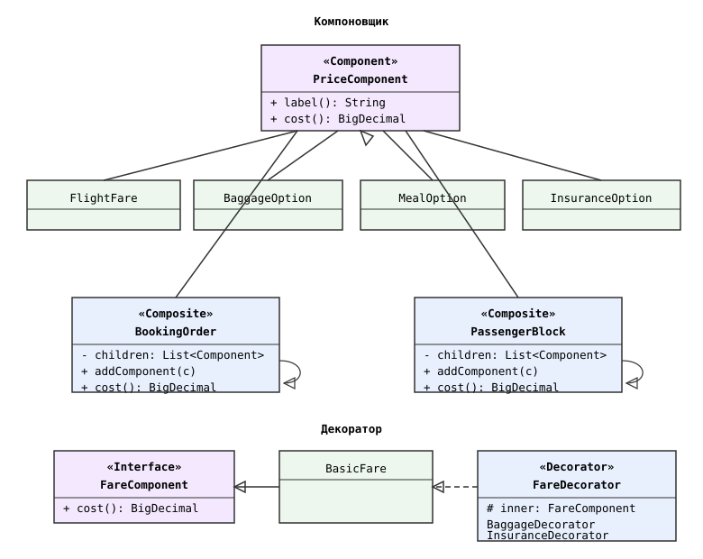
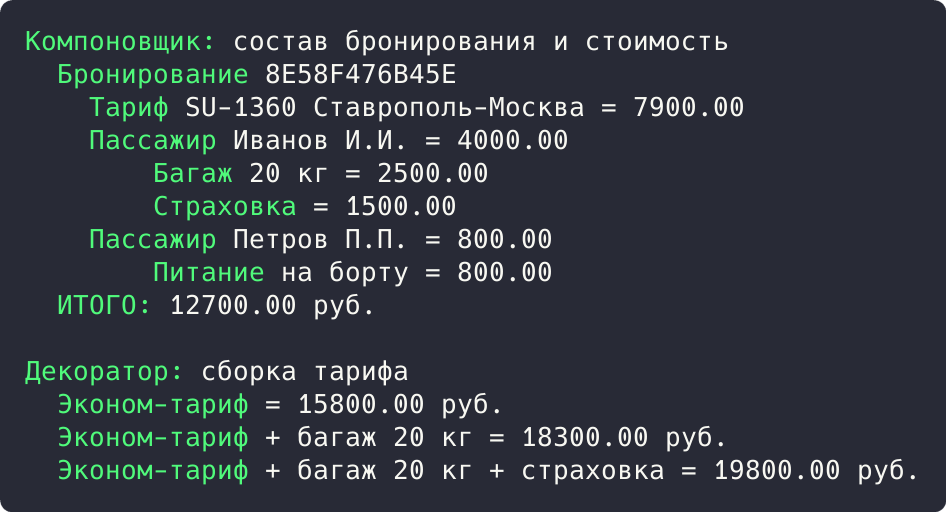

## Цель работы

Реализовать решение задачи из предметной области с использованием структурных паттернов «Компоновщик» и «Декоратор». Предметная область: приложение бронирования авиабилетов aviacassa (Java, Spring Boot).

## Краткие теоретические сведения

**Компоновщик (Composite)** объединяет объекты в древовидную структуру и позволяет работать с группой объектов так же, как с отдельным объектом: листы и группы реализуют один общий интерфейс, а группа делегирует операцию своим детям.

**Декоратор (Decorator)** добавляет объектам новые обязанности на лету: декоратор реализует тот же интерфейс, что и обернутый объект, хранит ссылку на него и выполняет собственную работу до, после или вместо вызова обернутого объекта.

## Ход работы

### Анализ кода приложения

Паттерн «Компоновщик» применяется при расчете стоимости бронирования: стоимость строится как дерево компонентов (заказ содержит тариф и блоки пассажиров, блок содержит услуги). Единый интерфейс PriceComponent позволяет считать сумму рекурсивно, не различая листы и группы.

```java
@Entity
@Builder
public class Booking {

    @Column(name = "total_amount", nullable = false)
    private BigDecimal totalAmount;

    @Builder.Default
    private List<Passenger> passengers = new ArrayList<>();

    @Builder.Default
    private List<Ticket> tickets = new ArrayList<>();
}
```

Паттерн «Декоратор» применяется в подсистеме безопасности: JwtAuthenticationFilter встраивается в цепочку фильтров Spring Security методом addFilterBefore() и добавляет извлечение JWT-токена, не изменяя остальные фильтры.

```java
@Bean
public SecurityFilterChain filterChain(HttpSecurity http)
        throws Exception {
    http
        .authorizeHttpRequests(auth -> auth
            .requestMatchers(HttpMethod.POST, "/auth/login").permitAll()
            .anyRequest().authenticated()
        )
        .addFilterBefore(jwtAuthenticationFilter,
                UsernamePasswordAuthenticationFilter.class);
    return http.build();
}
```

### Демонстрационная программа

Для демонстрации написана программа на Java. Компоновщик построен на интерфейсе PriceComponent: листы и группы имеют одинаковые операции, группы делегируют cost() детям. Декоратор построен на FareComponent: декораторы прибавляют свою стоимость к стоимости обернутого тарифа.

```java
interface PriceComponent {
    String label();
    BigDecimal cost();
    void print(String indent);
}

class PassengerBlock implements PriceComponent {
    private final List<PriceComponent> children = new ArrayList<>();

    public void addComponent(PriceComponent component) {
        children.add(component);
    }

    @Override
    public BigDecimal cost() {
        BigDecimal total = BigDecimal.ZERO;
        for (PriceComponent child : children) {
            total = total.add(child.cost());
        }
        return total;
    }

    @Override
    public void print(String indent) {
        System.out.println(indent + label() + " = " + cost());
        for (PriceComponent child : children) {
            child.print(indent + "    ");
        }
    }
}
```

```java
interface FareComponent {
    BigDecimal cost();
    String describe();
}

abstract class FareDecorator implements FareComponent {
    protected final FareComponent inner;

    protected FareDecorator(FareComponent inner) {
        this.inner = inner;
    }
}

class BaggageDecorator extends FareDecorator {

    @Override
    public BigDecimal cost() {
        return inner.cost().add(new BigDecimal("2500.00"));
    }

    @Override
    public String describe() {
        return inner.describe() + " + багаж 20 кг";
    }
}
```

Диаграмма классов демонстрационной программы приведена на рисунке 1.



*Рисунок 1 - Диаграмма классов паттернов «Компоновщик» и «Декоратор»*

В точке входа программы собирается дерево стоимости бронирования с двумя пассажирами, а затем тариф трижды оборачивается декораторами:

```java
public static void main(String[] args) {
    System.out.println("Компоновщик: состав бронирования и стоимость");
    BookingOrder order = new BookingOrder("8E58F476B45E");
    order.addComponent(new FlightFare());
    PassengerBlock first = new PassengerBlock("Иванов И.И.");
    first.addComponent(new BaggageOption());
    first.addComponent(new InsuranceOption());
    PassengerBlock second = new PassengerBlock("Петров П.П.");
    second.addComponent(new MealOption());
    order.addComponent(first);
    order.addComponent(second);
    order.print("  ");
    System.out.println("  ИТОГО: " + order.cost() + " руб.");

    System.out.println();
    System.out.println("Декоратор: сборка тарифа");
    FareComponent fare = new BasicFare();
    show(fare);
    fare = new BaggageDecorator(fare);
    show(fare);
    fare = new InsuranceDecorator(fare);
    show(fare);
}

private static void show(FareComponent fare) {
    System.out.printf("  %s = %s руб.%n", fare.describe(), fare.cost());
```

Результат запуска программы показан на рисунке 2.



*Рисунок 2 - Результат выполнения программы*

Результат: компоновщик вывел дерево брони 8E58F476B45E (тариф 7900.00, услуги пассажиров, итого 12700.00 руб. рекурсивным суммированием). Декораторы нарастили тариф: 15800.00, 18300.00 (багаж), 19800.00 руб. (страховка).

## Вывод

Изучены структурные паттерны «Компоновщик» и «Декоратор». В aviacassa компоновщик считает стоимость бронирования как дерево компонентов, декоратор применяется в цепочке фильтров Spring Security и при сборке тарифа. Работа паттернов подтверждена демонстрационной программой.
