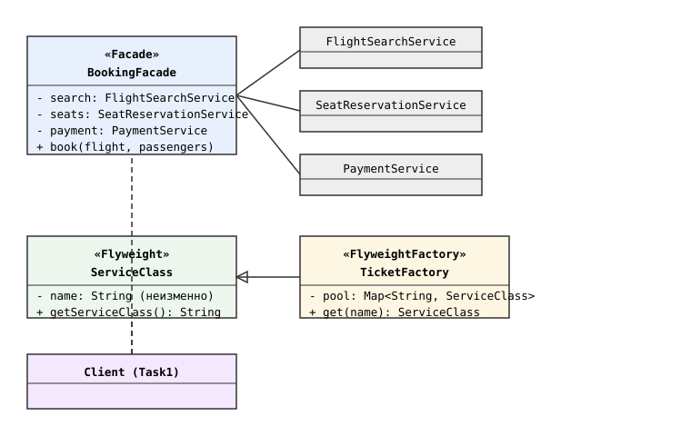
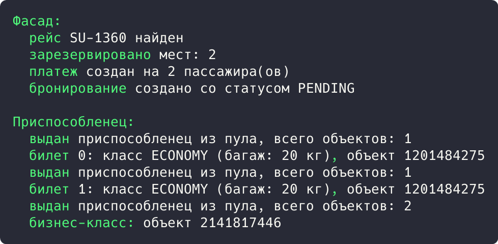

## Цель работы

Реализовать решение задачи из предметной области с использованием структурных паттернов «Фасад» и «Приспособленец». Предметная область: приложение бронирования авиабилетов aviacassa (Java, Spring Boot).

## Краткие теоретические сведения

**Фасад (Facade)** предоставляет простой интерфейс к сложной подсистеме классов: клиент вызывает один метод фасада, а тот координирует вызовы нескольких сервисов подсистемы.

**Приспособленец (Flyweight)** экономит память, разделяя общее состояние между множеством мелких объектов: неизменяемые объекты создаются один раз и хранятся в пуле, а клиенты получают ссылки на них.

## Ход работы

### Анализ кода приложения

Паттерн «Фасад» применяется на слое контроллеров: BookingController принимает HTTP-запросы и скрывает от клиента всю подсистему (валидацию, BookingServiceImpl, репозитории, мапперы DTO). Клиент работает с простыми конечными точками, не зная о внутреннем взаимодействии сервисов.

```java
@RestController
@RequestMapping("/bookings")
@RequiredArgsConstructor
public class BookingController {

    private final IBookingService bookingService;

    @PostMapping
    public ResponseEntity<BookingDTO> create(
            @RequestBody BookingRequest request) {
        return ResponseEntity.status(HttpStatus.CREATED)
                .body(bookingService.createBooking(request));
    }
}
```

Паттерн «Приспособленец» применяется в перечислениях проекта: BookingStatus, PaymentMethod, TicketStatus существуют в единственном экземпляре на каждое значение и разделяются всеми сущностями. Значения не создаются заново для каждого бронирования, а берутся из общего пула JVM.

```java
public enum BookingStatus {
    PENDING,
    CONFIRMED,
    CANCELLED,
    EXPIRED
}
```

### Демонстрационная программа

Для демонстрации написана программа на Java. Фасад BookingFacade скрывает три сервиса подсистемы (поиск рейса, резервирование мест, платеж) за одним методом book(). Приспособленец ServiceClass создается один раз и раздается всем билетам через пул TicketFactory.

```java
class BookingFacade {
    private final FlightSearchService search = new FlightSearchService();
    private final SeatReservationService seats = new SeatReservationService();
    private final PaymentService payment = new PaymentService();

    public void book(String flightNumber, String[] passengers) {
        System.out.println("  " + search.find(flightNumber));
        System.out.println("  " + seats.reserve(passengers.length));
        System.out.println("  " + payment.init(passengers.length));
        System.out.println("  бронирование создано со статусом PENDING");
    }
}
```

```java
class TicketFactory {
    private static final Map<String, ServiceClass> pool = new HashMap<>();

    public static ServiceClass get(String name) {
        pool.computeIfAbsent(name,
                n -> new ServiceClass(n, n.equals("BUSINESS") ? "40 кг" : "20 кг"));
        return pool.get(name);
    }
}
```

Диаграмма классов приведена на рисунке 1.



*Рисунок 1 - Диаграмма классов паттернов «Фасад» и «Приспособленец»*

В точке входа клиент бронирует рейс через фасад и получает два билета эконом-класса и один бизнес-класс:

```java
public static void main(String[] args) {
    System.out.println("Фасад:");
    BookingFacade facade = new BookingFacade();
    facade.book("SU-1360", new String[]{"Иванов И.И.", "Петров П.П."});

    System.out.println();
    System.out.println("Приспособленец:");
    for (int i = 0; i < 2; i++) {
        ServiceClass economy = TicketFactory.get("ECONOMY");
        System.out.println("  билет " + i + ": " + economy.getServiceClass()
                + ", объект " + economy.hashCode());
    }
    ServiceClass business = TicketFactory.get("BUSINESS");
    System.out.println("  бизнес-класс: объект " + business.hashCode());
}
```

Результат запуска программы показан на рисунке 2.



*Рисунок 2 - Результат выполнения программы*

Результат: фасад выполнил бронирование четырьмя вызовами подсистем за один метод book(). Приспособленец выдал два билета эконом-класса из одного объекта (одинаковый хеш-код 1201484275), бизнес-класс получил отдельный объект, всего в пуле два объекта.

## Вывод

Изучены структурные паттерны «Фасад» и «Приспособленец». В aviacassa фасадом служит слой контроллеров над сервисами, приспособленцами являются перечисления статусов. Работа паттернов подтверждена демонстрационной программой.
