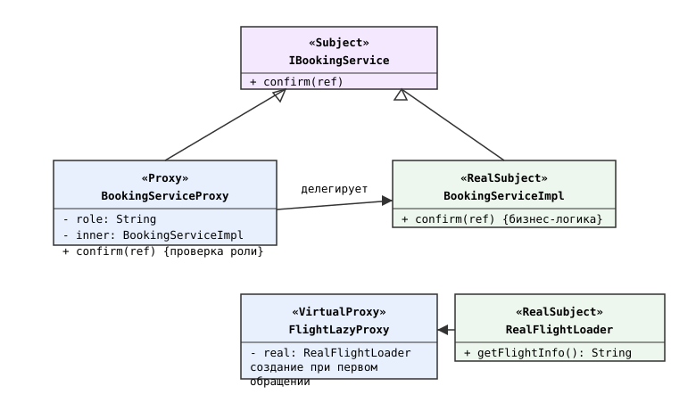
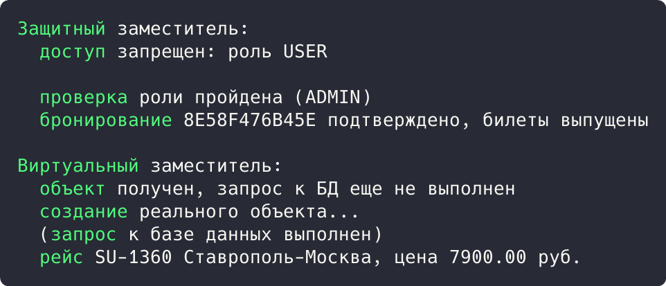

## Цель работы

Реализовать решение задачи из предметной области с использованием структурного паттерна «Заместитель». Предметная область: приложение бронирования авиабилетов aviacassa (Java, Spring Boot).

## Краткие теоретические сведения

**Заместитель (Proxy)** подменяет реальный объект, реализуя его интерфейс, и контролирует доступ к нему. Защитный заместитель проверяет права вызывающего, виртуальный создает тяжелый объект только при первом обращении.

## Ход работы

### Анализ кода приложения

В проекте применяются оба вида заместителя. Защитный: JwtAuthenticationFilter перехватывает каждый запрос до контроллера, проверяет JWT-токен и пускает дальше только аутентифицированные вызовы; клиент работает с контроллером через заместителя, не зная о проверке.

```java
@Bean
public SecurityFilterChain filterChain(HttpSecurity http)
        throws Exception {
    http
        .authorizeHttpRequests(auth -> auth
            .requestMatchers(HttpMethod.POST, "/auth/login").permitAll()
            .anyRequest().authenticated()
        )
        .addFilterBefore(jwtAuthenticationFilter,
                UsernamePasswordAuthenticationFilter.class);
    return http.build();
}
```

Виртуальный: связи сущностей помечены FetchType.LAZY, поэтому Hibernate подставляет вместо реального Flight прокси-объект, а запрос к базе выполняется только при первом обращении к полям рейса.

```java
@Entity
@Builder
public class Booking {

    @ManyToOne(fetch = FetchType.LAZY)
    @JoinColumn(name = "flight_id", nullable = false)
    private Flight flight;
}
```

### Демонстрационная программа

Для демонстрации написана программа на Java. Защитный заместитель BookingServiceProxy проверяет роль пользователя до вызова BookingServiceImpl. Виртуальный заместитель FlightLazyProxy создает RealFlightLoader только при первом обращении.

```java
class BookingServiceProxy implements IBookingService {
    private final String role;
    private final BookingServiceImpl inner;

    public BookingServiceProxy(String role) {
        this.role = role;
        this.inner = new BookingServiceImpl();
    }

    @Override
    public void confirm(String bookingReference) {
        if (!role.equals("ADMIN")) {
            System.out.println("  доступ запрещен: роль " + role);
            return;
        }
        System.out.println("  проверка роли пройдена (ADMIN)");
        inner.confirm(bookingReference);
    }
}
```

```java
class FlightLazyProxy implements IFlightLoader {
    private RealFlightLoader real;

    @Override
    public String getFlightInfo() {
        if (real == null) {
            System.out.println("  создание реального объекта...");
            real = new RealFlightLoader();
        }
        return real.getFlightInfo();
    }
}
```

Диаграмма классов приведена на рисунке 1.



*Рисунок 1 - Диаграмма классов паттерна «Заместитель»*

В точке входа подтверждение бронирования вызывается с ролями USER и ADMIN, затем читается информация о рейсе через ленивый заместитель:

```java
public static void main(String[] args) {
    System.out.println("Защитный заместитель:");
    IBookingService user = new BookingServiceProxy("USER");
    user.confirm("8E58F476B45E");
    IBookingService admin = new BookingServiceProxy("ADMIN");
    admin.confirm("8E58F476B45E");

    System.out.println();
    System.out.println("Виртуальный заместитель:");
    IFlightLoader lazy = new FlightLazyProxy();
    System.out.println("  объект получен, запрос к БД еще не выполнен");
    System.out.println("  " + lazy.getFlightInfo());
}
```

Результат запуска программы показан на рисунке 2.



*Рисунок 2 - Результат выполнения программы*

Результат: заместитель отклонил вызов с ролью USER и пропустил вызов с ролью ADMIN к реальному сервису. Ленивый заместитель вернул объект без запроса к базе, а при первом обращении создал RealFlightLoader и выполнил запрос.

## Вывод

Изучен структурный паттерн «Заместитель». В aviacassa защитный заместитель реализован фильтром JWT-аутентификации, виртуальный: ленивыми связями Hibernate (FetchType.LAZY). Работа паттерна подтверждена демонстрационной программой.
