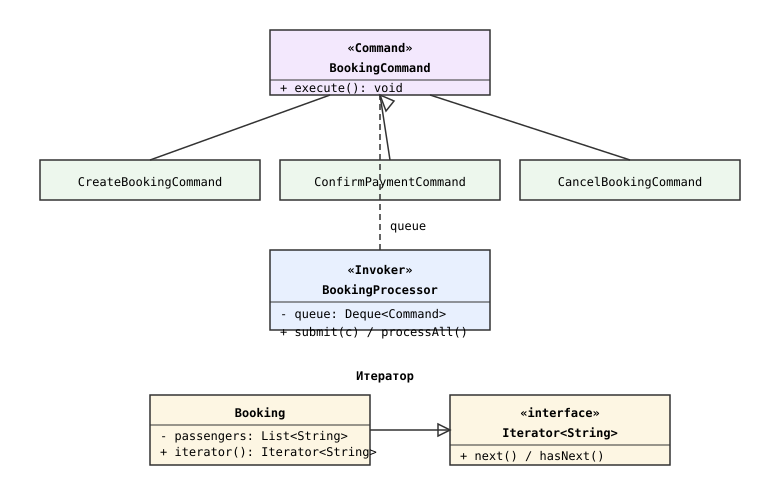
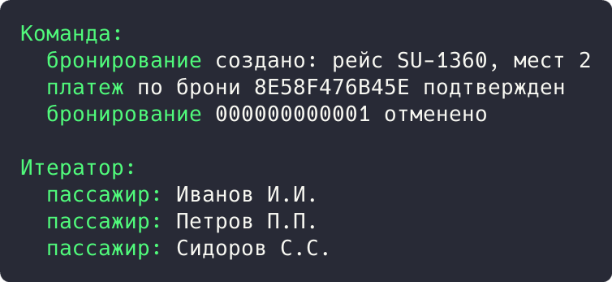

## Цель работы

Реализовать решение задачи из предметной области с использованием поведенческих паттернов «Команда» и «Итератор». Предметная область: приложение бронирования авиабилетов aviacassa (Java, Spring Boot).

## Краткие теоретические сведения

**Команда (Command)** заворачивает операцию в отдельный объект с методом execute(): команды можно накапливать в очереди, логировать и выполнять независимо от клиента.

**Итератор (Iterator)** последовательно обходит элементы коллекции, не раскрывая ее внутреннее устройство: клиент пользуется методами hasNext() и next().

## Ход работы

### Анализ кода приложения

Паттерн «Команда» применяется на слое контроллеров: каждая конечная точка (создание брони, подтверждение платежа, отмена) инкапсулирует операцию в отдельном методе-обработчике, который получает объект запроса (BookingRequest, PaymentWebhookDTO) и делегирует выполнение сервису. Запросы-команды постановки в очередь использует платежный вебхук: события внешней системы обрабатываются последовательно.

```java
@PostMapping("/{id}/cancel")
public ResponseEntity<BookingDTO> cancel(@PathVariable Long id) {
    return ResponseEntity.ok(bookingService.cancel(id));
}
```

Паттерн «Итератор» применяется при обходе коллекций сущностей: сервис бронирований проходит по спискам пассажиров и билетов бронирования стандартным итератором, не обращаясь к внутреннему устройству списков JPA.

```java
booking.getPassengers().stream()
        .map(p -> Ticket.builder()
                .booking(booking)
                .passenger(p)
                .status(TicketStatus.ISSUED)
                .build())
        .toList();
```

### Демонстрационная программа

Для демонстрации написана программа на Java. Команды CreateBookingCommand, ConfirmPaymentCommand и CancelBookingCommand инкапсулируют операции; инвокер BookingProcessor накапливает их в очереди и выполняет. Booking реализует Iterable и отдает итератор по пассажирам.

```java
interface BookingCommand {
    void execute();
}

class ConfirmPaymentCommand implements BookingCommand {
    private final String reference;

    public ConfirmPaymentCommand(String reference) {
        this.reference = reference;
    }

    @Override
    public void execute() {
        System.out.println("  платеж по брони " + reference + " подтвержден");
    }
}

class BookingProcessor {
    private final Deque<BookingCommand> queue = new ArrayDeque<>();

    public void submit(BookingCommand command) {
        queue.add(command);
    }

    public void processAll() {
        while (!queue.isEmpty()) {
            queue.poll().execute();
        }
    }
}
```

Диаграмма классов приведена на рисунке 1.



*Рисунок 1 - Диаграмма классов паттернов «Команда» и «Итератор»*

В точке входа три команды ставятся в очередь и выполняются, затем бронирование обходится итератором:

```java
public static void main(String[] args) {
    BookingProcessor processor = new BookingProcessor();
    processor.submit(new CreateBookingCommand("SU-1360", 2));
    processor.submit(new ConfirmPaymentCommand("8E58F476B45E"));
    processor.submit(new CancelBookingCommand("000000000001"));
    processor.processAll();

    Booking booking = new Booking("8E58F476B45E");
    booking.addPassenger("Иванов И.И.");
    booking.addPassenger("Петров П.П.");
    booking.addPassenger("Сидоров С.С.");
    Iterator<String> it = booking.iterator();
    while (it.hasNext()) {
        System.out.println("  пассажир: " + it.next());
    }
}
```

Результат запуска программы показан на рисунке 2.



*Рисунок 2 - Результат выполнения программы*

Результат: инвокер выполнил три команды из очереди в порядке постановки (создание, подтверждение платежа, отмена). Итератор выдал всех трех пассажиров бронирования без доступа к внутреннему списку.

## Вывод

Изучены поведенческие паттерны «Команда» и «Итератор». В aviacassa команды соответствуют обработчикам контроллеров и вебхуков, итераторы применяются при обходе коллекций JPA-сущностей. Работа паттернов подтверждена демонстрационной программой.
