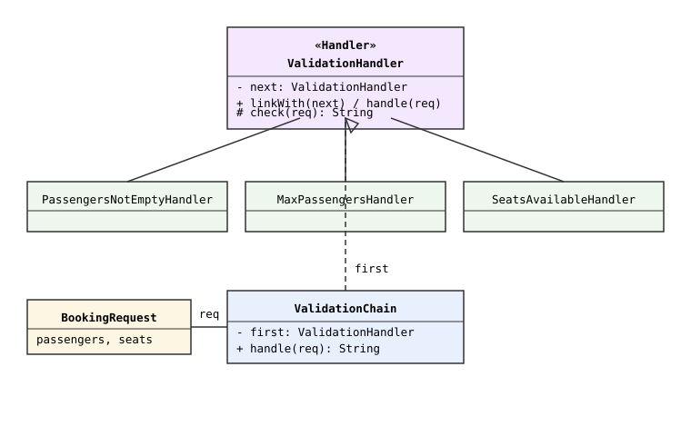
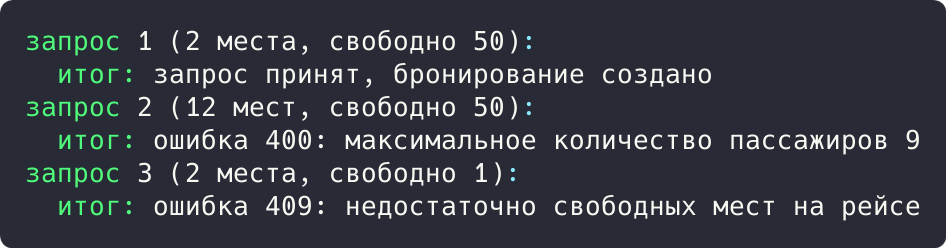

## Цель работы

Реализовать решение задачи из предметной области с использованием поведенческого паттерна «Цепочка обязанностей». Предметная область: приложение бронирования авиабилетов aviacassa (Java, Spring Boot).

## Краткие теоретические сведения

**Цепочка обязанностей (Chain of Responsibility)** передает запрос последовательно по цепочке обработчиков: каждый обработчик либо отклоняет запрос, либо передает его следующему. Обработчики связаны в цепочку динамически и не знают друг о друге.

## Ход работы

### Анализ кода приложения

В проекте применяются две цепочки обязанностей. Первая: цепочка фильтров Spring Security, в которую встроен JwtAuthenticationFilter; запрос последовательно проходит фильтры, и каждый решает, обработать его или передать дальше. Вторая: последовательные проверки в createBooking() (список пассажиров не пуст, не более девяти пассажиров, достаточно мест), каждая из которых либо отклоняет запрос с ошибкой, либо передает управление следующей.

```java
if (passengers == null || passengers.isEmpty()) {
    throw new ValidationException("Список пассажиров не может быть пустым");
}
if (passengers.size() > 9) {
    throw new ValidationException("Максимальное количество пассажиров 9");
}
Flight flight = flightRepository.findById(flightId)
        .orElseThrow(() -> new ValidationException("Рейс не найден"));
if (flight.getAvailableSeats() < passengers.size()) {
    throw new InsufficientSeatsException("Недостаточно свободных мест");
}
```

Ошибка, не обработанная в сервисе, попадает в GlobalExceptionHandler, где каждый обработчик исключения отвечает за свой тип: ValidationException дает 400, InsufficientSeatsException дает 409, PaymentFailedException дает 502.

### Демонстрационная программа

Для демонстрации написана программа на Java. Обработчики PassengersNotEmptyHandler, MaxPassengersHandler и SeatsAvailableHandler связаны в цепочку методом linkWith(). Запрос BookingRequest проходит цепочку от первого обработчика; первый нарушенный инвариант возвращает ошибку с HTTP-кодом.

```java
abstract class ValidationHandler {
    private ValidationHandler next;

    public ValidationHandler linkWith(ValidationHandler next) {
        this.next = next;
        return next;
    }

    public String handle(BookingRequest request) {
        String error = check(request);
        if (error != null) {
            return error;
        }
        return next != null ? next.handle(request)
                : "запрос принят, бронирование создано";
    }

    protected abstract String check(BookingRequest request);
}

class SeatsAvailableHandler extends ValidationHandler {
    @Override
    protected String check(BookingRequest request) {
        if (request.availableSeats < request.passengers) {
            return "ошибка 409: недостаточно свободных мест на рейсе";
        }
        return null;
    }
}
```

Диаграмма классов приведена на рисунке 1.



*Рисунок 1 - Диаграмма классов паттерна «Цепочка обязанностей»*

В точке входа через цепочку пропускаются три запроса: корректный, с превышением лимита пассажиров и без свободных мест:

```java
public static void main(String[] args) {
    ValidationChain chain = new ValidationChain();
    BookingRequest ok = new BookingRequest(2, 50);
    BookingRequest tooMany = new BookingRequest(12, 50);
    BookingRequest noSeats = new BookingRequest(2, 1);
    System.out.println("запрос 1 (2 места, свободно 50):");
    System.out.println("  итог: " + chain.handle(ok));
    System.out.println("запрос 2 (12 мест, свободно 50):");
    System.out.println("  итог: " + chain.handle(tooMany));
    System.out.println("запрос 3 (2 места, свободно 1):");
    System.out.println("  итог: " + chain.handle(noSeats));
}
```

Результат запуска программы показан на рисунке 2.



*Рисунок 2 - Результат выполнения программы*

Результат: корректный запрос прошел всех трех обработчиков и принят; запрос с двенадцатью пассажирами отклонен вторым обработчиком (ошибка 400); запрос без мест отклонен третьим (ошибка 409).

## Вывод

Изучен поведенческий паттерн «Цепочка обязанностей». В aviacassa цепочки применяются в фильтрах Spring Security, проверках бронирования и обработчиках исключений GlobalExceptionHandler. Работа паттерна подтверждена демонстрационной программой.
