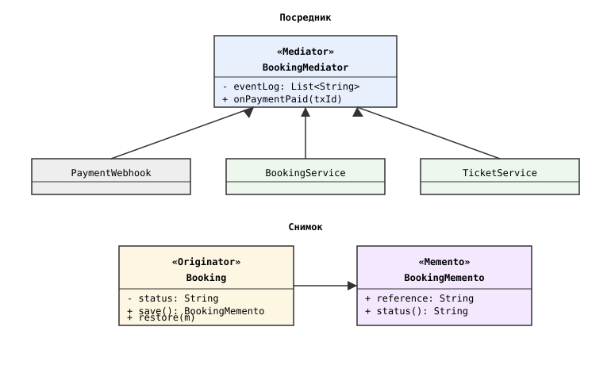
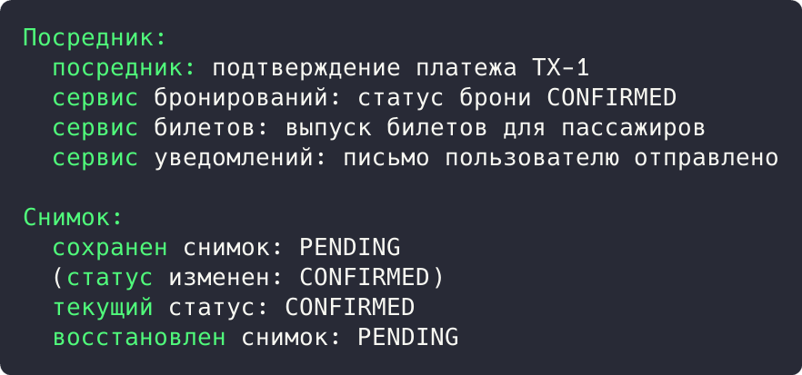

## Цель работы

Реализовать решение задачи из предметной области с использованием поведенческих паттернов «Посредник» и «Снимок». Предметная область: приложение бронирования авиабилетов aviacassa (Java, Spring Boot).

## Краткие теоретические сведения

**Посредник (Mediator)** убирает прямые связи между объектами: участники сообщают посреднику о событиях, а он координирует их реакции. **Снимок (Memento)** сохраняет и восстанавливает состояние объекта, не нарушая инкапсуляции.

## Ход работы

## Анализ кода приложения

Паттерн «Посредник» применяется в обработке платежного вебхука: PaymentController не обращается к сервисам напрямую. Он вызывает единственный метод processWebhook() сервиса платежей, который при получении статуса PAID координирует остальных: переводит бронирование в CONFIRMED и выпускает билеты. Сервис платежей выступает посредником между внешней системой и остальной подсистемой.

```java
@Override
@Transactional
public void processWebhook(String transactionId, PaymentStatus status) {
    Payment payment = paymentRepository
            .findByTransactionId(transactionId)
            .orElseThrow(() -> new ValidationException(
                    "Платеж с указанным transactionId не найден"));
    ...
    if (status == PaymentStatus.PAID) {
        booking.setStatus(BookingStatus.CONFIRMED);
        List<Ticket> tickets = booking.getPassengers().stream()
                .map(p -> Ticket.builder().booking(booking)
                        .passenger(p).status(TicketStatus.ISSUED).build())
                .toList();
        booking.getTickets().addAll(tickets);
    }
}
```

Паттерн «Снимок» применяется в жизненном цикле бронирования: сущность хранит даты создания и обновления (аннотации @CreationTimestamp, @UpdateTimestamp), а история статусов PENDING, CONFIRMED, CANCELLED, EXPIRED позволяет восстановить состояние брони на момент события.

## Демонстрационная программа

Для демонстрации написана программа на Java. Посредник BookingMediator принимает событие об оплате и сам координирует сервисы бронирований, билетов и уведомлений; вебхук не знает об этих сервисах. Снимок BookingMemento (record) сохраняет статус брони, метод restore() возвращает сохраненное состояние.

```java
class BookingMediator {
    private final List<String> eventLog = new ArrayList<>();

    public void onPaymentPaid(String transactionId) {
        eventLog.add("платеж " + transactionId + " подтвержден");
        System.out.println("  посредник: подтверждение платежа " + transactionId);
        notifyBooking("статус брони CONFIRMED");
        notifyTickets("выпуск билетов для пассажиров");
        notifyNotification("письмо пользователю отправлено");
    }
}

record BookingMemento(String reference, String status, LocalDateTime savedAt) {}
```

Диаграмма классов приведена на рисунке 1.



*Рисунок 1 - Диаграмма классов паттернов «Посредник» и «Снимок»*

В точке входа вебхук сообщает посреднику об оплате, затем бронирование меняет статус, сохраняет снимок и восстанавливает его:

```java
public static void main(String[] args) {
    BookingMediator mediator = new BookingMediator();
    PaymentWebhook.process("TX-1", "PAID", mediator);

    Booking booking = new Booking("8E58F476B45E", "PENDING");
    BookingMemento saved = booking.save();
    booking.setStatus("CONFIRMED");
    booking.restore(saved);
}
```

Результат запуска программы показан на рисунке 2.



*Рисунок 2 - Результат выполнения программы*

Результат: посредник по одному событию оплаты скоординировал три сервиса (бронирование подтверждено, билеты выпущены, письмо отправлено). Снимок сохранил статус PENDING, после изменения на CONFIRMED восстановление вернуло исходный статус.

## Вывод

Изучены поведенческие паттерны «Посредник» и «Снимок». В aviacassa посредником выступает сервис платежей, координирующий подсистемы при оплате, снимки применяются к жизненному циклу статусов бронирования. Работа паттернов подтверждена демонстрационной программой.
